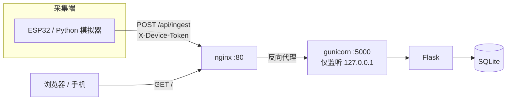

# Watchtower · 设备监测与告警台

一个自己从零搭起来、跑在公网服务器上的设备监测系统：设备上报温湿度 → 服务端校验入库 → 规则判定告警 → 网页实时展示。

做它的目的不只是「有个能跑的东西」，而是完整走一遍**从写代码到把服务交付出去**的过程：上机加固、非 root 运行、进程托管与自愈、反向代理、日志审计。

## 现在的状态

服务端已部署在公网服务器上并持续运行，浏览器可直接访问面板。

| 部分 | 状态 |
| --- | --- |
| Flask 服务端 + SQLite + 日志 | 已上线运行 |
| 面板（实时刷新、告警列表、手机自适应） | 已上线运行 |
| 令牌鉴权（`X-Device-Token`） | 已验证：无令牌 → `401` |
| gunicorn 托管（2 worker） | 已上线运行 |
| systemd 自愈 + 开机自启 | 已验证：`kill -9` 后 3 秒恢复；`reboot` 后自动拉起 |
| nginx 反向代理（80 → 127.0.0.1:5000） | 已验证：公网可访问 |
| 主机加固（仅密钥登录、禁密码、禁 root、双层防火墙） | 已完成 |
| ESP32 采集固件 | 代码就绪，**未在实机验证** |
| HTTPS、自动备份、面板登录鉴权 | **未做**（见「已知边界」） |

## 架构



三层入口是刻意设计的：**公网只能碰到 nginx，应用只听回环地址**。80 是特权端口，由 root 拥有的 nginx 绑定；应用以非 root 用户在 5000 上跑，即使应用被攻破也拿不到特权端口。

## 接口

| 方法 | 路径 | 说明 | 鉴权 |
| --- | --- | --- | --- |
| GET | `/` | 面板页面 | 无（见已知边界） |
| GET | `/healthz` | 健康检查，不查库，保证永远快 | 无 |
| POST | `/api/ingest` | 上报一条读数 | `X-Device-Token` |
| GET | `/api/readings?limit=20` | 最近 N 条读数 | 无 |
| GET | `/api/status` | 在线状态 + 最新读数 + 近期告警 | 无 |

上报示例：

```bash
curl -X POST http://SERVER_IP/api/ingest \
  -H "Content-Type: application/json" \
  -H "X-Device-Token: $WATCHTOWER_DEVICE_TOKEN" \
  -d '{"device_id":"lab-01","temperature":26.5,"humidity":48.0}'
# 201 {"ok":true,"created_at":"..."}
```

错误码的分工很清楚：`401` 令牌不对、`400` 字段类型或范围不合法（温度 -40~125、湿度 0~100）、`405`/`404` 请求根本没到应用（nginx 层就挡了）。

## 本地运行

```bash
python -m venv .venv
.venv/Scripts/python -m pip install -r requirements.txt   # Windows
cp .env.example .env        # 改成你自己的令牌
python app.py
```

另开一个窗口跑采集端（默认每 10 秒上报一次模拟读数）：

```bash
python collector.py
```

浏览器打开 <http://127.0.0.1:5000>。想用手机在同一 WiFi 下看，把 `WATCHTOWER_HOST` 设成 `0.0.0.0` 再启动；云服务器上千万别这么干，那等于绕过 nginx 直接暴露应用。

## 部署到公网

两份手册，都是按实际操作和排障过程写的，不是抄文档：

- [`deploy/01-secure-the-host.md`](deploy/01-secure-the-host.md) —— 上机加固：密钥登录、禁密码、禁 root、创建非 root 用户、双层防火墙（云控制台 + ufw）。含三向验证方法与六个过渡态规则表。
- [`deploy/02-deploy-watchtower.md`](deploy/02-deploy-watchtower.md) —— 部署：代码上传、venv、`.env`、gunicorn、systemd 单元、nginx 反向代理。含 `reload` 与 `restart` 的差异、`nginx -T` 排查法。

配套文件：

```
deploy/watchtower.service         systemd 单元（Restart=always + RestartSec=3）
deploy/watchtower.nginx.conf      nginx 站点配置（含真实访客 IP 透传）
```

## 安全设计

- **密钥不进代码、不进 Git**：`.env` 被忽略，仓库里只有 `.env.example`
- **令牌放请求头而非 URL**：避免出现在访问日志、浏览器历史和代理缓存里
- **服务端不信任客户端**：类型与范围都校验；`limit` 有上下限，防止一次拉爆整张表
- **参数化 SQL**：值永远不拼进 SQL 字符串
- **前端只用 `textContent` 渲染外部数据**：`device_id` 来自设备，拼进 `innerHTML` 就是 XSS 入口
- **聚合在服务端做**：离线判定依赖时间差，各设备时钟不一致，放前端算会互相打架
- **健康检查不查库**：给进程守护用的接口要保证永远快
- **`debug=False`**：Flask 调试器允许远程执行代码
- **日志轮转**：单文件 1MB、留 3 份，不会写满磁盘
- **应用只听 `127.0.0.1`**：公网入口统一由 nginx 承担，应用本身不可从外部直连

## 已知边界

写清楚没做到的部分，比只写做成了什么更有用：

- **面板 `/` 没有登录鉴权**，任何人拿到地址都能查看数据。当前数据不敏感，可接受；接入真实场景前必须加认证。
- **全链路是明文 HTTP**，设备令牌在公网上传输时可被嗅探。需要配置 HTTPS。
- **没有自动备份**，也没有做过删库恢复演练。没验证过恢复的备份等于没有备份。
- **ESP32 固件未在实机验证**，`esp32/watchtower_sensor/` 下的代码是按 `/api/ingest` 契约写的，尚未烧录测试。
- **单机部署**，没有多副本、没有监控告警、没有集中日志。

## 目录

```
app.py                         服务端路由：/、/healthz、/api/ingest、/api/readings、/api/status
config.py                      统一读取 .env（含告警阈值、离线时限）
collector.py                   采集端：每 10 秒上报一条模拟读数
templates/index.html           面板结构（Flask 同源提供，无需 CORS）
static/style.css               面板样式，含手机端响应式
static/app.js                  面板逻辑，每 5 秒刷新
esp32/watchtower_sensor/       ESP32 采集固件（WiFi + HTTP POST）
deploy/                        加固与部署手册、systemd 单元、nginx 配置
.env.example                   配置模板
```

## License

MIT
